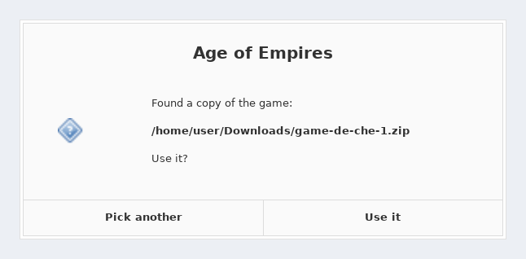
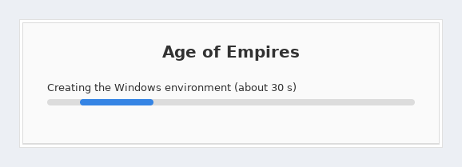
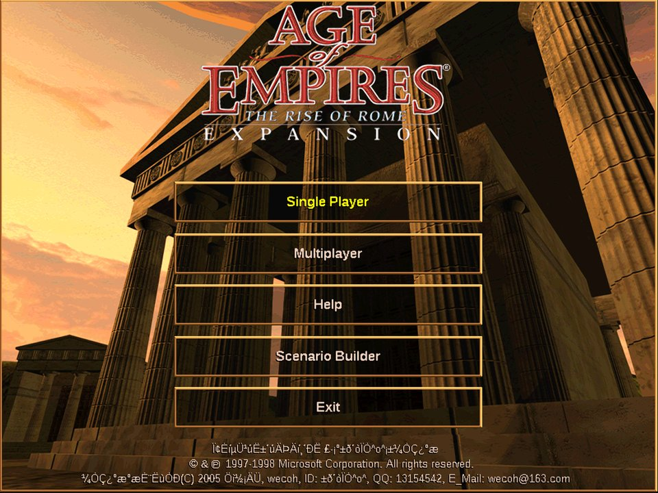

<p align="center">
  
</p>

<p align="center"><b>Age of Empires on Linux, in one click</b> 🇻🇳<br>
Age of Empires, Rise of Rome and Age of Empires II on Ubuntu: no Bottles, no
Flatpak, no gamescope, no sudo, no step-by-step clicking.</p>

<p align="center">Made in Vietnam, where the game is still called Đế Chế</p>

<p align="center"><a href="README.md">Tiếng Việt</a> · <a href="README.en.md">English</a></p>

[](https://github.com/DucLong06/aoe-linux/actions/workflows/ci.yml)


## Install

### Step 1: download the game

aoe-linux ships no game. Download `game-de-che-1.zip` (~51 MB) into your
**Downloads** folder and keep the name:

👉 https://drive.google.com/file/d/1-9N9TB4zAQj8ssXu_eYm8x4yH-ATPbwa/view

If Google says it "can't scan this file for viruses", click **Download anyway**.

### Step 2: install aoe-linux

```sh
wget https://github.com/DucLong06/aoe-linux/releases/latest/download/aoe-linux_all.deb
sudo apt install ./aoe-linux_all.deb
```

Without sudo, into `~/.local`:

```sh
curl -fsSL https://raw.githubusercontent.com/DucLong06/aoe-linux/main/install.sh | sh
```

**Arch Linux**: install the libraries with pacman, then run the `install.sh` line above:

```sh
sudo pacman -S --needed curl xz unzip libx11 libxext libxrender libxrandr libxi libxcursor \
  libxcomposite libxinerama freetype2 fontconfig mesa libpulse gnutls ttf-liberation zenity
```

### Step 3: open the game

Open **Age of Empires** from the app menu.

1. aoe-linux finds the zip from step 1; click **Use it**:

   

2. Wait 1–2 minutes (the first run downloads Wine, ~95 MB, and resumes if the network drops):

   

3. The game starts. From then on the icon goes straight into the game.

   

The terminal works too:

```sh
aoe-linux setup ~/Downloads/game-de-che-1.zip   # import the game
aoe-linux                                       # play
```

The zip in Downloads is only needed for this import; delete it afterwards.

In game the keys are always plain English: input methods (IBus, Fcitx, Unikey,
Bamboo, Pinyin) are switched off **for the game only**; other apps keep them.

## LAN play

Everyone installs aoe-linux and joins the same network. aoe-linux installs
Microsoft's DirectPlay from the game's own `Dplay60a.exe` (Wine's DirectPlay cannot
host a game), pre-selects TCP/IP and fills in the player name.

- **Host:** Multiplayer → OK → Create → name the game → OK → pick the map → tick
  I'm Ready! → Start Game once everyone is in and ready.
- **Join:** Multiplayer → OK → Show Games → leave the address box **empty** and
  press OK (searches the LAN) → pick the game → Join → tick I'm Ready!
- "Internet TCP/IP Connection For DirectPlay" is the right connection type for LAN
  too. Game not found: type the host's IP (`aoe-linux lan` shows it). Rename:
  `aoe-linux name "New name"`.

> [!IMPORTANT]
> **Open the firewall on EVERY machine** (host and joiners). Windows asks "Allow?"
> the first time; Ubuntu's `ufw` does not, it silently drops the connection. If
> `sudo ufw status` says `active`, run on each machine (use your own subnet, see
> `ip -4 addr`; for a VPN repeat with its subnet, e.g. `10.99.0.0/24`):
>
> ```sh
> sudo ufw allow from 192.168.1.0/24 to any port 47624 proto tcp
> sudo ufw allow from 192.168.1.0/24 to any port 47624 proto udp
> sudo ufw allow from 192.168.1.0/24 to any port 2300:2400 proto tcp
> sudo ufw allow from 192.168.1.0/24 to any port 2300:2400 proto udp
> ```
- Tested: two fresh installs in docker on one network, host + LAN search + join,
  both reached the game.

## Behind a proxy

The first run downloads Wine and cnc-ddraw from GitHub. On a network that needs a
proxy (replace `http://proxy.example.com:8080` with yours):

```sh
export https_proxy=http://proxy.example.com:8080 http_proxy=http://proxy.example.com:8080
wget https://github.com/DucLong06/aoe-linux/releases/latest/download/aoe-linux_all.deb
sudo -E apt install ./aoe-linux_all.deb      # -E passes the proxy to apt
aoe-linux proxy http://proxy.example.com:8080   # menu launches do not see https_proxy: save it once
```

`aoe-linux proxy` shows the saved proxy, `aoe-linux proxy off` removes it. If
`sudo -E` is not enough, set `Acquire::http::Proxy` and `Acquire::https::Proxy` in
`/etc/apt/apt.conf.d/95proxy`. Downloads resume after a dropped connection and are
checked by sha256.

## Right-click menu

Right-click the icon in the dock or the app menu:

- **Play in a window**: `Alt+Enter` also toggles in game.
- **Display settings**: cnc-ddraw's settings window (shader, aspect, renderer).
- **Open game folder**: saves, maps, campaigns, mods.
- **Import the game again**: switch to another copy; your saves are kept.

The main icon plays Rise of Rome. If the folder also holds Age of Empires II, it
gets its own menu entry. The right-click menu also has **LAN play: how to + this
machine's address**.

## Commands

| Command | Does |
|---|---|
| `aoe-linux` | Play (Rise of Rome by default) |
| `aoe-linux play aoe2 \| aoe2x` | Play Age of Empires II / The Conquerors |
| `aoe-linux windowed` | Play in a window |
| `aoe-linux setup [ZIP\|FOLDER\|URL]` | Import or re-import the game |
| `aoe-linux display` | Display settings |
| `aoe-linux folder` | Open the game folder |
| `aoe-linux doctor` | Check the machine and the install when something breaks |
| `aoe-linux proxy [URL\|off]` | Save, show or remove the download proxy |
| `aoe-linux lan` | LAN how-to and this machine's address |
| `aoe-linux name ["Name"]` | Show or set the player name |
| `aoe-linux ime [on\|off]` | Input method in game: off by default (`on` keeps the desktop one) |
| `aoe-linux repair` | Redo DirectPlay, registry and menu entries |
| `aoe-linux uninstall` | Remove the game, saves and Wine (asks first) |

To remove it all: `aoe-linux uninstall`, then
`sudo apt remove aoe-linux` (or `sh install.sh --uninstall` for the no-sudo install).
Messages follow your system language (English or Vietnamese); force one with `AOE_LANG=en`.

## Troubleshooting

- Run `aoe-linux doctor`: Wine version, missing libraries, fonts, GPU and the
  tail of the last run's log (`~/.local/share/aoe-linux/last-run.log`).
- Boxes instead of text in game: `sudo apt install fonts-liberation`.
- Nothing appears on the first click: `sudo apt install zenity`, or set up from
  a terminal with `aoe-linux setup <file.zip>`.
- A pasted Drive link says "The link gives a web page": Google Drive hit its
  download limit. Download it in a browser as in step 1 and pick **A .zip file**.
- "Cannot unpack ... game-de-che-1.zip": you run aoe-linux 0.1.2 or older, which
  mistook zips re-packed on Windows for broken ones. Update to 0.1.3 (install the
  latest `.deb`) and run it again.
- Chinese repacks show one garbled credits line on the main menu. It comes from
  the repack and does not affect play.

## Tested

- **Ubuntu 24.04**: imported the `game-de-che-1.zip` of step 1, main menu, Single
  Player → Random Map → Start Game, in game with legible text. LAN game between
  two docker machines.
- **Ubuntu 26.04 LTS, Ubuntu 26.10**: blank docker machine, `.deb` install, game
  import, the game keeps running, `aoe-linux doctor` says "All good".
- **Arch Linux**: blank docker machine, pacman libraries + `install.sh`, game
  import, main menu reached (the step 3 picture).
- Input method: on all three, with IBus set in the environment (`GTK_IM_MODULE=ibus`),
  the game runs with it switched off (`XMODIFIERS=@im=none`).

Not tested: sound, a real GPU on Arch/Ubuntu 26, typing with a live IBus/Unikey
daemon, Age of Empires II with real game
files. Report problems in [Issues](https://github.com/DucLong06/aoe-linux/issues).

## Built on

- [Wine](https://www.winehq.org/), portable build by [Kron4ek/Wine-Builds](https://github.com/Kron4ek/Wine-Builds)
- [cnc-ddraw](https://github.com/FunkyFr3sh/cnc-ddraw) by FunkyFr3sh
- Both are pinned by version and sha256 in the script; every download is verified.

MIT licensed. Age of Empires is a trademark of Microsoft; this project is not
affiliated with Microsoft.

<p align="center">Thanks to <a href="https://github.com/NousResearch/hermes-agent">Hermes</a> and <a href="https://claude.ai">Claude</a> for building this project together 🇻🇳</p>
