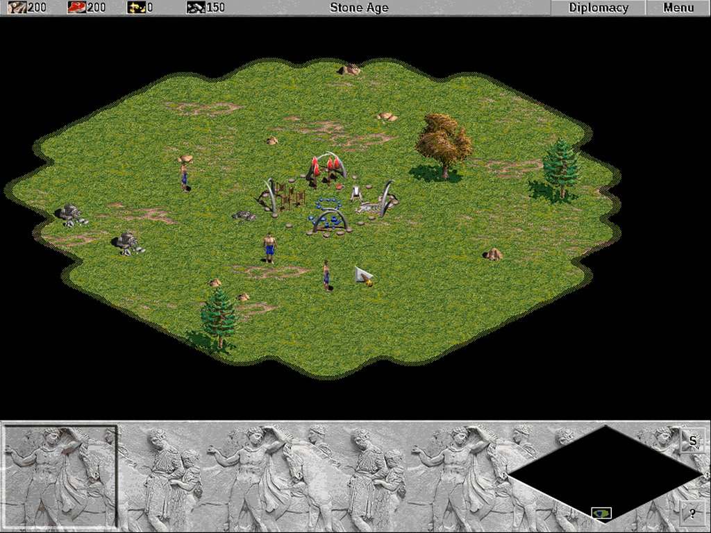

<p align="center">
  
</p>

<p align="center"><b>Age of Empires on Linux, in one click</b> 🇻🇳<br>
Age of Empires, Rise of Rome and Age of Empires II on Ubuntu: no Bottles, no
Flatpak, no gamescope, no sudo, no step-by-step clicking.</p>

<p align="center">Made in Vietnam, where the game is still called Đế Chế</p>

<p align="center"><a href="README.md">Tiếng Việt</a> · <a href="README.en.md">English</a></p>

[](https://github.com/DucLong06/aoe-linux/actions/workflows/ci.yml)



## Install

```sh
wget https://github.com/DucLong06/aoe-linux/releases/latest/download/aoe-linux_all.deb
sudo apt install ./aoe-linux_all.deb
```

Without sudo, into `~/.local`:

```sh
curl -fsSL https://raw.githubusercontent.com/DucLong06/aoe-linux/main/install.sh | sh
```

Then open **Age of Empires** from the app menu. The first click:

1. Looks for a copy you already have: an install made with Bottles (the old
   guide), or a `.zip` named like `aoe`, `empire`, `de-che` in Downloads.
2. Otherwise asks where the game is: a **.zip file**, an unpacked **folder**,
   or a **download link** (Google Drive, Dropbox and OneDrive share links work as-is).
3. Downloads Wine (~95 MB, once, resumes when the network drops), builds the
   environment, copies the game in and starts it. About 1–2 minutes.

After that a click starts the game. The terminal works too:

```sh
aoe-linux setup ~/Downloads/aoe.zip   # import the game
aoe-linux                             # play
```

> This repo ships no game files (the game is copyrighted). Bring your own copy.

## LAN play

Everyone installs aoe-linux and joins the same network. aoe-linux installs
Microsoft's DirectPlay from the game's own `Dplay60a.exe` (Wine's DirectPlay cannot
host a game), pre-selects TCP/IP and fills in the player name.

- **Host:** Multiplayer → OK → Create → name the game → OK → pick the map → tick
  I'm Ready! → Start Game once everyone is in and ready.
- **Join:** Multiplayer → OK → Show Games → leave the address box **empty** and
  press OK (searches the LAN) → pick the game → Join → tick I'm Ready!
- "Internet TCP/IP Connection For DirectPlay" is the right connection type for LAN
  too. Game not found: type the host's IP (`aoe-linux lan` shows it). Rename:
  `aoe-linux name "New name"`. With ufw on: allow 47624/tcp and 2300:2400 tcp+udp.
- Tested: two fresh installs in docker on one network, host + LAN search + join,
  both reached the game.

To share the game with friends, upload the zip to Google Drive, share it as
"Anyone with the link" and have them paste the link into the first-run dialog
(or `aoe-linux setup "<link>"`).

## Behind a proxy

The first run downloads Wine and cnc-ddraw from GitHub. On a network that needs a
proxy (replace `http://proxy.example.com:8080` with yours):

```sh
export https_proxy=http://proxy.example.com:8080 http_proxy=http://proxy.example.com:8080
wget https://github.com/DucLong06/aoe-linux/releases/latest/download/aoe-linux_all.deb
sudo -E apt install ./aoe-linux_all.deb      # -E passes the proxy to apt
aoe-linux proxy http://proxy.example.com:8080   # menu launches do not see https_proxy: save it once
```

`aoe-linux proxy` shows the saved proxy, `aoe-linux proxy off` removes it. If
`sudo -E` is not enough, set `Acquire::http::Proxy` and `Acquire::https::Proxy` in
`/etc/apt/apt.conf.d/95proxy`. Downloads resume after a dropped connection and are
checked by sha256.

## What it replaces

| Old way (Bottles) | aoe-linux |
|---|---|
| Install Flatpak, Flathub, Bottles, gamescope (over 1 GB) | One small package; portable Wine ~95 MB on first run |
| Create a bottle, disable DXVK/VKD3D, pick Windows 7 | Done for you |
| Install allfonts, cnc-ddraw, directplay by hand | cnc-ddraw built in; Arial mapped to Liberation; DirectPlay from the game's `Dplay60a.exe` |
| Copy the game into the virtual C: drive, set the working directory | Pick the zip; registry and paths are written for you |
| Tune gamescope 1024x768 → 1920x1080 + FSR | cnc-ddraw: borderless fullscreen, 4:3 kept, FSR sharpening |
| Type `NOSTARTUP` to skip the intro | Added for you |
| Game jumps to the portrait monitor | No monitor mode switch; if it still lands wrong, `Super+Shift+←/→` |

Wine is the WoW64 build, so 32-bit games run without any i386 system libraries.

## Right-click menu

Right-click the icon in the dock or the app menu:

- **Play in a window**: `Alt+Enter` also toggles in game.
- **Display settings**: cnc-ddraw's settings window (shader, aspect, renderer).
- **Open game folder**: saves, maps, campaigns, mods.
- **Import the game again**: switch to another copy; your saves are kept.

The main icon plays Rise of Rome. If the folder also holds Age of Empires II, it
gets its own menu entry. The right-click menu also has **LAN play: how to + this
machine's address**.

## Commands

| Command | Does |
|---|---|
| `aoe-linux` | Play (Rise of Rome by default) |
| `aoe-linux play aoe2 \| aoe2x` | Play Age of Empires II / The Conquerors |
| `aoe-linux windowed` | Play in a window |
| `aoe-linux setup [ZIP\|FOLDER\|URL]` | Import or re-import the game |
| `aoe-linux display` | Display settings |
| `aoe-linux folder` | Open the game folder |
| `aoe-linux doctor` | Check the machine and the install when something breaks |
| `aoe-linux proxy [URL\|off]` | Save, show or remove the download proxy |
| `aoe-linux lan` | LAN how-to and this machine's address |
| `aoe-linux name ["Name"]` | Show or set the player name |
| `aoe-linux repair` | Redo DirectPlay, registry and menu entries |
| `aoe-linux uninstall` | Remove the game, saves and Wine (asks first) |

Everything lives in `~/.local/share/aoe-linux`; downloads are cached in
`~/.cache/aoe-linux`. To remove it all: `aoe-linux uninstall`, then
`sudo apt remove aoe-linux` (or `sh install.sh --uninstall` for the no-sudo install).
Messages follow your system language (English or Vietnamese); force one with `AOE_LANG=en`.

## Troubleshooting

- Run `aoe-linux doctor`: Wine version, missing libraries, fonts, GPU and the
  tail of the last run's log (`~/.local/share/aoe-linux/last-run.log`).
- Boxes instead of text in game: `sudo apt install fonts-liberation`.
- Nothing appears on the first click: `sudo apt install zenity`, or set up from
  a terminal with `aoe-linux setup <file.zip>`.
- Chinese repacks show one garbled credits line on the main menu. It comes from
  the repack and does not affect play.

## Tested

Ubuntu 24.04 with Rise of Rome: imported from a zip, main menu, Single Player →
Random Map → Start Game, in game with legible text. The `.deb` is install-tested
on a blank Ubuntu 24.04 in docker. Age of Empires II is supported but not yet
tested with real game files. Report problems in [Issues](https://github.com/DucLong06/aoe-linux/issues).

## Built on

- [Wine](https://www.winehq.org/), portable build by [Kron4ek/Wine-Builds](https://github.com/Kron4ek/Wine-Builds)
- [cnc-ddraw](https://github.com/FunkyFr3sh/cnc-ddraw) by FunkyFr3sh
- Both are pinned by version and sha256 in the script; every download is verified.

MIT licensed. Age of Empires is a trademark of Microsoft; this project is not
affiliated with Microsoft.

<p align="center">Thanks to <a href="https://github.com/NousResearch/hermes-agent">Hermes</a> and <a href="https://claude.ai">Claude</a> for building this project together 🇻🇳</p>
