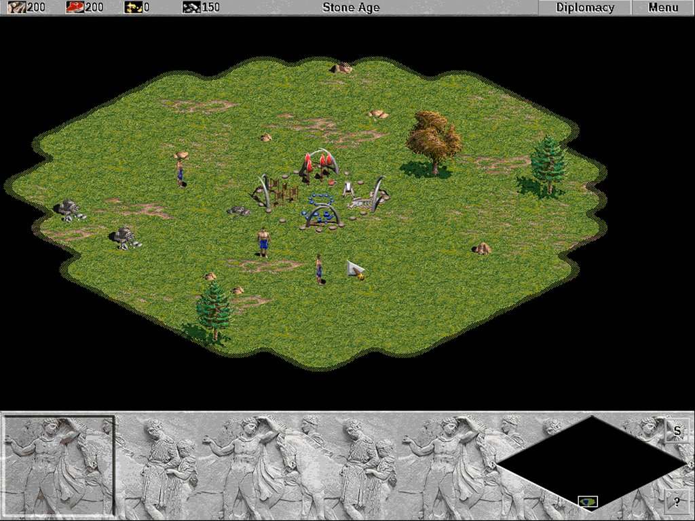
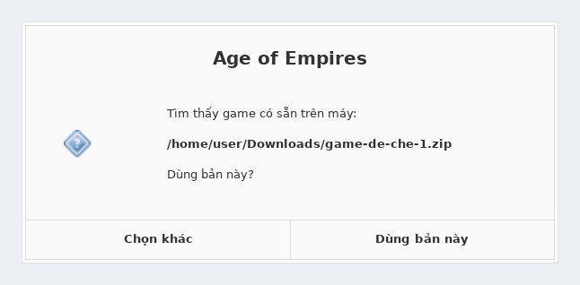
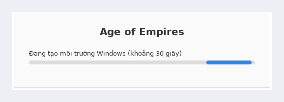
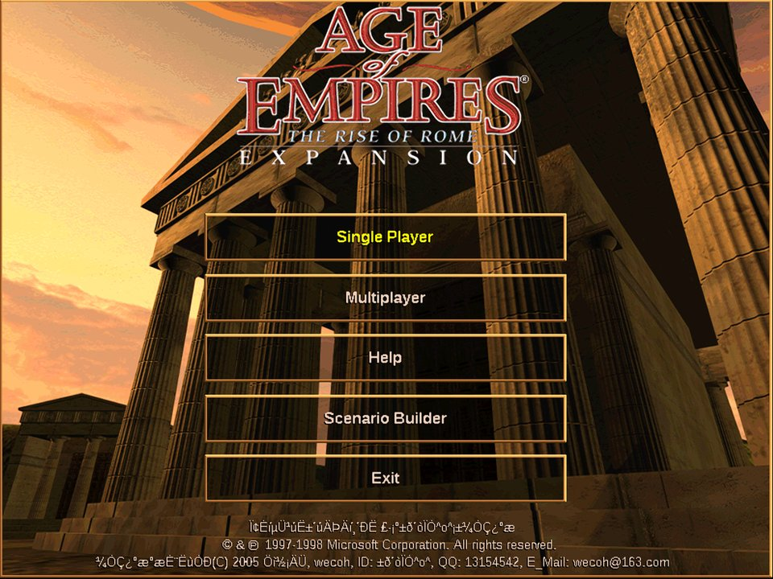

<p align="center">
  
</p>

<p align="center"><b>Đế Chế trên Linux</b>: bấm một lần là chơi Age of Empires 🇻🇳<br>
Age of Empires, Rise of Rome và Age of Empires II chạy trên Ubuntu mà không cần
Bottles, Flatpak hay gamescope, không cần sudo, không phải bấm tay từng bước.</p>

<p align="center"><a href="README.md">Tiếng Việt</a> · <a href="README.en.md">English</a></p>

[](https://github.com/DucLong06/aoe-linux/actions/workflows/ci.yml)



## Cài đặt

### Bước 1: tải file game

aoe-linux không kèm game. Tải file `game-de-che-1.zip` (~51 MB) về thư mục
**Downloads**, giữ nguyên tên:

👉 https://drive.google.com/file/d/1-9N9TB4zAQj8ssXu_eYm8x4yH-ATPbwa/view

Google báo "không thể quét virus" thì bấm **Vẫn tải xuống**.

### Bước 2: cài aoe-linux

```sh
wget https://github.com/DucLong06/aoe-linux/releases/latest/download/aoe-linux_all.deb
sudo apt install ./aoe-linux_all.deb
```

Không có sudo thì cài vào `~/.local`:

```sh
curl -fsSL https://raw.githubusercontent.com/DucLong06/aoe-linux/main/install.sh | sh
```

**Arch Linux**: cài thư viện bằng pacman rồi chạy dòng `install.sh` ở trên:

```sh
sudo pacman -S --needed curl xz unzip libx11 libxext libxrender libxrandr libxi libxcursor \
  libxcomposite libxinerama freetype2 fontconfig mesa libpulse gnutls ttf-liberation zenity
```

### Bước 3: mở game

Mở **Age of Empires** trong menu ứng dụng.

1. aoe-linux tự tìm thấy file zip ở bước 1, bấm **Dùng bản này**:

   

2. Chờ khoảng 1–2 phút (lần đầu tải Wine ~95 MB, mạng đứt thì tự tải tiếp):

   

3. Vào game. Từ lần sau bấm icon là vào thẳng.

   

Dùng terminal cũng được:

```sh
aoe-linux setup ~/Downloads/game-de-che-1.zip   # nhập game từ file zip
aoe-linux                                       # chơi
```

File zip trong Downloads chỉ cần cho lần nhập này, cài xong xoá được.

Khi chơi, game luôn nhận phím tiếng Anh: bộ gõ (Unikey, Bamboo, IBus, Fcitx) tự
tắt **riêng trong game**, các app khác vẫn gõ tiếng Việt bình thường.

## Chơi LAN

Mọi người cài aoe-linux và cùng một mạng (cùng wifi hoặc cùng switch). aoe-linux
đã làm sẵn mấy việc: cài DirectPlay của Microsoft (lấy từ file `Dplay60a.exe` có
sẵn trong thư mục game, vì DirectPlay của Wine không tạo phòng được), chọn sẵn
kiểu kết nối TCP/IP và điền sẵn tên người chơi.

> [!IMPORTANT]
> **Phải mở tường lửa trên TẤT CẢ các máy chơi**, cả máy tạo phòng lẫn máy vào
> phòng. Nếu không, vào phòng sẽ không thấy phòng hoặc bị treo ở bước Join.
>
> Windows tự hiện hộp thoại "Allow" lần đầu chơi nên ít ai để ý. Ubuntu bật `ufw`
> thì chặn im lặng. Từ bản 0.1.5, khi mở game mà `ufw` đang bật, aoe-linux **tự hỏi**
> *"Tường lửa đang chặn chơi LAN. Mở cổng?"*: bấm **Mở cổng**, nhập mật khẩu là xong
> (chỉ mở cho mạng nội bộ máy đang dùng, cả LAN lẫn VPN). Bấm nhầm "Không hỏi lại"
> thì chạy `aoe-linux firewall` để mở bằng tay.
>
> `aoe-linux firewall status` in ra đúng các lệnh cho mạng của máy bạn. Muốn tự gõ thì
> phải dùng **đúng dải mạng**, ví dụ máy `192.168.1.25/24` thì dải là `192.168.1.0/24`:
>
> ```sh
> sudo ufw allow from 192.168.1.0/24 to any port 47624 proto tcp
> sudo ufw allow from 192.168.1.0/24 to any port 47624 proto udp
> sudo ufw allow from 192.168.1.0/24 to any port 2300:2400 proto tcp
> sudo ufw allow from 192.168.1.0/24 to any port 2300:2400 proto udp
> ```
>
> Cẩn thận với mạng không phải `/24`: máy `10.20.30.200/26` thì dải là
> `10.20.30.192/26`, **không phải** `10.20.30.0/26` (dải đó không chứa máy của bạn,
> mở cũng như không). Không chắc thì dùng `aoe-linux firewall status`.

**Tạo phòng** (một người):
Multiplayer → **OK** → **Create** → gõ tên phòng → **OK** → chọn bản đồ → tick
**I'm Ready!** → **Start Game** khi mọi người đã vào và tick sẵn sàng.

**Vào phòng** (những người còn lại):
Multiplayer → **OK** → **Show Games** → hiện ô hỏi địa chỉ: **để trống, bấm OK**
(tự tìm phòng trong mạng LAN) → chọn phòng → **Join** → tick **I'm Ready!**

Kiểu kết nối tên là "Internet TCP/IP Connection For DirectPlay", nghe như chơi
qua Internet nhưng đây chính là kiểu dùng cho mạng LAN, cứ để nguyên.

- Không thấy phòng: gõ địa chỉ IP của máy tạo phòng vào ô hỏi địa chỉ. Xem IP:
  chuột phải icon → **Chơi LAN: hướng dẫn và địa chỉ máy này**, hoặc `aoe-linux lan`.
- Đổi tên người chơi: `aoe-linux name "Tên mới"`.
- Vẫn không vào được: chạy `aoe-linux firewall status` ở **cả hai máy** và kiểm tra dải
  mạng (mục ở trên). Chơi qua VPN thì DirectPlay vẫn báo IP LAN cho máy kia, nên hai
  máy nên chung mạng LAN.
- Đã thử: hai máy ảo (docker) chung một mạng, cài mới từ đầu. Một máy tạo phòng,
  máy kia để trống địa chỉ, tự tìm thấy phòng, vào phòng, cả hai vào trận.

## Mạng cần proxy (công ty, trường học)

Lần đầu chạy, aoe-linux cần tải Wine và cnc-ddraw từ GitHub (file game bạn đã tự
tải ở bước 1). Nếu mạng phải đi qua
proxy thì làm thêm các bước sau (thay `http://proxy.congty.vn:8080` bằng proxy
của bạn):

**1. Cài gói `.deb` qua proxy**

```sh
export https_proxy=http://proxy.congty.vn:8080 http_proxy=http://proxy.congty.vn:8080
wget https://github.com/DucLong06/aoe-linux/releases/latest/download/aoe-linux_all.deb
sudo -E apt install ./aoe-linux_all.deb      # -E để apt dùng proxy vừa đặt
```

`sudo -E` không ăn thì đặt proxy cho apt một lần:

```sh
echo 'Acquire::http::Proxy "http://proxy.congty.vn:8080"; Acquire::https::Proxy "http://proxy.congty.vn:8080";' \
  | sudo tee /etc/apt/apt.conf.d/95proxy
```

Cài không sudo cũng vậy: `export https_proxy=...` rồi chạy dòng `curl ... | sh`.

**2. Proxy cho aoe-linux**

Từ bản 0.1.5, bấm icon là aoe-linux tự dùng proxy theo thứ tự: proxy đã lưu bằng
`aoe-linux proxy`, rồi biến `https_proxy`, rồi **proxy đặt trong Settings → Network
→ Proxy** của máy (chế độ Manual). Máy đã đặt proxy trong Settings thì không phải làm
gì thêm. Nếu không, lưu một lần:

```sh
aoe-linux proxy http://proxy.congty.vn:8080   # lưu
aoe-linux proxy                               # xem đang dùng proxy nào, lấy từ đâu
aoe-linux proxy off                           # bỏ proxy đã lưu
```

Tải hỏng thì cửa sổ báo lỗi ghi rõ lý do (không tìm thấy máy chủ, hết thời gian chờ,
lỗi kết nối bảo mật...) kèm proxy đang dùng.

## Menu chuột phải

Bấm chuột phải vào icon trên dock hoặc trong menu ứng dụng:

- **Chơi LAN: hướng dẫn và địa chỉ máy này**: các bước tạo/vào phòng và IP của máy.
- **Chơi trong cửa sổ**: trong game, `Alt+Enter` cũng chuyển qua lại.
- **Cài đặt hiển thị**: mở cửa sổ cấu hình của cnc-ddraw (shader, tỉ lệ, renderer).
- **Mở thư mục game**: save, bản đồ, campaign, mod.
- **Nhập lại game**: đổi bản khác; save cũ được giữ.

Icon chính mở Rise of Rome. Có Age of Empires II trong thư mục game thì menu có
thêm mục cho AoE II.

## Lệnh

| Lệnh | Việc |
|---|---|
| `aoe-linux` | Chơi (mặc định là Rise of Rome) |
| `aoe-linux play aoe2 \| aoe2x` | Chơi Age of Empires II / The Conquerors |
| `aoe-linux windowed` | Chơi trong cửa sổ |
| `aoe-linux setup [ZIP\|THƯ_MỤC\|LINK]` | Nhập hoặc nhập lại game từ bản của bạn |
| `aoe-linux display` | Cài đặt hiển thị |
| `aoe-linux folder` | Mở thư mục game |
| `aoe-linux doctor` | Kiểm tra máy và bản cài khi có lỗi |
| `aoe-linux proxy [URL\|off]` | Lưu, xem hoặc bỏ proxy để tải |
| `aoe-linux lan` | Hướng dẫn chơi LAN và địa chỉ IP máy này |
| `aoe-linux firewall [open\|status\|never\|ask]` | Mở cổng LAN trong ufw, xem lệnh cho mạng của máy, tắt/bật câu hỏi |
| `aoe-linux perf [smooth\|sharp\|safe]` | `smooth` (mặc định): mọi nhân CPU + OpenGL, mượt. `sharp`: thêm FSR cho nét hơn (cần card rời). `safe`: chế độ cũ, một nhân CPU |
| `aoe-linux name ["Tên"]` | Xem hoặc đổi tên người chơi |
| `aoe-linux ime [on\|off]` | Bộ gõ trong game: mặc định tắt (`on` để dùng bộ gõ của máy) |
| `aoe-linux repair` | Làm lại DirectPlay, registry, menu khi có trục trặc |
| `aoe-linux uninstall` | Xoá game, save và Wine (có hỏi trước) |

Gỡ hẳn: `aoe-linux uninstall` rồi `sudo apt remove aoe-linux`
(hoặc `sh install.sh --uninstall` nếu cài không sudo).

## Gặp lỗi

- **Game giật khi cuộn bản đồ:** từ 0.1.6 mặc định đã là chế độ mượt (`aoe-linux perf smooth`).
  Bản cnc-ddraw gốc ép cả game chạy trên **một nhân CPU** (`singlecpu=true`) và đi qua
  Direct3D9, mà trên Wine thì Direct3D9 lại phải dịch sang OpenGL. Đổi sang dùng mọi
  nhân + OpenGL trực tiếp thì đo được nhiều hơn khoảng 60% khung hình khi cuộn bản đồ.
  Bộ phóng ảnh FSR (bản 0.1.1 tới 0.1.5) nặng với card đồ họa onboard, nên mặc định quay về
  bilinear như bản repack. Máy có card rời muốn nét hơn thì dùng `aoe-linux perf sharp`.
  Nếu ở chế độ mượt mà game bị đơ hoặc mất tiếng, chạy `aoe-linux perf safe` để quay
  về chế độ cũ.

- Chạy `aoe-linux doctor`: báo phiên bản Wine, thư viện còn thiếu, font, GPU, proxy,
  tường lửa, và các lỗi chính của lần chơi gần nhất.
- **Game bị thoát đột ngột (crash):** aoe-linux hiện thông báo kèm đường dẫn file log.
  Log của **5 lần chơi gần nhất** nằm trong `~/.local/share/aoe-linux/logs/`
  (`last-run.log` trỏ tới lần mới nhất). Gửi file đó kèm việc đang làm lúc crash
  (Alt+Tab, đổi màn hình, đang chơi LAN...) khi báo lỗi.
- Chữ trong game bị ô vuông: `sudo apt install fonts-liberation`.
- Lần đầu bấm không thấy cửa sổ nào: `sudo apt install zenity`, hoặc cài bằng
  terminal với `aoe-linux setup <file.zip>`.
- Dán link Drive báo "Link trả về trang web": Google Drive tạm khoá vì quá nhiều
  lượt tải. Tải bằng trình duyệt như bước 1 rồi chọn **File .zip**.
- Báo "Không giải nén được ... game-de-che-1.zip": bạn đang dùng aoe-linux 0.1.2
  trở về trước, bản này nhận nhầm zip nén lại trên Windows là hỏng. Cập nhật lên
  0.1.3 (cài lại gói `.deb` mới nhất) rồi chạy lại.
- Tạo phòng báo "Unable to create game": chạy `aoe-linux repair` (cài lại DirectPlay).
- Bản repack tiếng Trung hiện một dòng chữ lỗi font ở màn hình chính. Lỗi có sẵn
  trong bản repack, không ảnh hưởng gì khi chơi.

## Đã thử

- **Ubuntu 24.04**: nhập từ file `game-de-che-1.zip` tải ở bước 1, vào menu chính,
  Single Player → Random Map → Start Game, vào trận, chữ rõ. Chơi LAN hai máy
  (docker) vào trận được.
- **Ubuntu 26.04 LTS, Ubuntu 26.10**: máy trắng trong docker, cài gói `.deb`, nhập
  game, game chạy ổn định, `aoe-linux doctor` báo "Mọi thứ ổn".
- **Arch Linux**: máy trắng trong docker, cài thư viện bằng pacman + `install.sh`,
  nhập game, vào tới màn hình chính (ảnh ở bước 3).
- Bộ gõ: trên cả ba bản, máy giả lập đang đặt IBus (`GTK_IM_MODULE=ibus`), game
  vẫn chạy với bộ gõ đã tắt (`XMODIFIERS=@im=none`).

Chưa thử: âm thanh, card đồ hoạ thật trên Arch/Ubuntu 26, gõ phím với IBus/Unikey
thật đang chạy, Age of Empires II với file
game thật. Báo lỗi ở [Issues](https://github.com/DucLong06/aoe-linux/issues).

## Dựa trên

- [Wine](https://www.winehq.org/), bản build portable của [Kron4ek/Wine-Builds](https://github.com/Kron4ek/Wine-Builds)
- [cnc-ddraw](https://github.com/FunkyFr3sh/cnc-ddraw) của FunkyFr3sh
- Phiên bản và sha256 của cả hai được ghim trong script, tải về đều được kiểm tra.

Giấy phép MIT. Age of Empires là thương hiệu của Microsoft; dự án này không liên
quan tới Microsoft.

<p align="center">Cảm ơn <a href="https://github.com/NousResearch/hermes-agent">Hermes</a> và <a href="https://claude.ai">Claude</a> đã cùng làm dự án này 🇻🇳</p>
